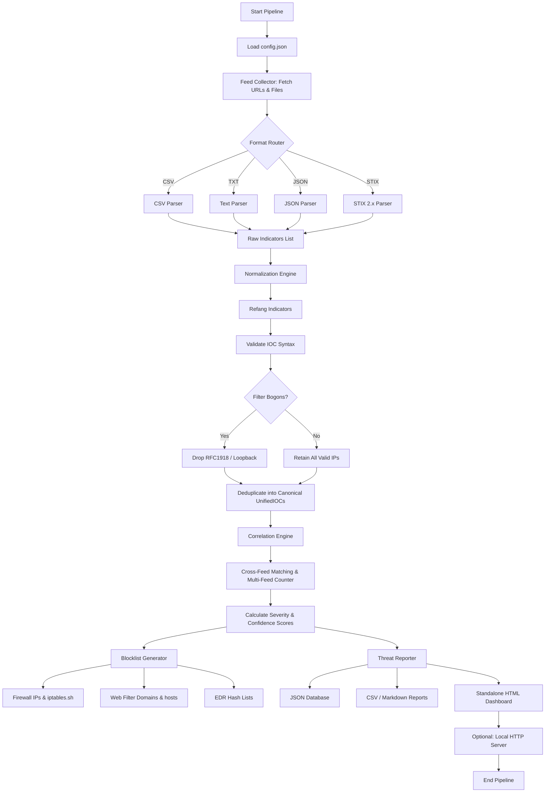

# Threat Intelligence Aggregator (Non-AI)
## Technical Documentation & Blue Team Implementation Guide

A deterministic, rule-based cybersecurity aggregator designed to collect, parse, normalize, and correlate Indicators of Compromise (IOCs) across heterogeneous internal and external threat feeds without relying on AI or machine learning models.

---

## Table of Contents
1. [Project Overview & Description](#1-project-overview--description)
2. [Practical Motivation](#2-practical-motivation)
3. [Project Objectives & Requirements Compliance](#3-project-objectives--requirements-compliance)
4. [Practical Scope of the Project](#4-practical-scope-of-the-project)
5. [Tools & Technologies Used](#5-tools--technologies-used)
6. [Practical Techniques Implemented](#6-practical-techniques-implemented)
7. [Workflow & Architecture](#7-workflow--architecture)
8. [Architecture Flowchart](#8-architecture-flowchart)
9. [Codebase & Component Architecture](#9-codebase--component-architecture)
10. [Configuration Schema (`config.json`)](#10-configuration-schema-configjson)
11. [Command Line Interface & Execution Guide](#11-command-line-interface--execution-guide)
12. [Generated Project Deliverables & Outputs](#12-generated-project-deliverables--outputs)
13. [Sample Feed Verification & Correlation Results](#13-sample-feed-verification--correlation-results)
14. [Learning Outcomes](#14-learning-outcomes)

---

## 1. Project Overview & Description

Modern Security Operations Centers (SOCs) and Cyber Threat Intelligence (CTI) teams ingest large volumes of Indicators of Compromise (IOCs)—such as malicious IP addresses, URLs, fully qualified domain names (FQDNs), and cryptographic file hashes (MD5, SHA1, SHA256)—distributed across disparate commercial providers, open-source intelligence (OSINT) platforms, government CERT bulletins, and internal security sensors (firewalls, EDR, SIEM).

These feeds suffer from:
- **Inconsistent Formats:** Unstructured text, comma-separated lists, complex JSON objects, and STIX 2.x bundles.
- **Data Inconsistencies:** Deliberately defanged indicators (`hxxps://`, `1[.]1[.]1[.]1`, `example[dot]com`), duplicate records, and RFC1918 private/bogon IPs.
- **Alert Fatigue:** Inability to immediately distinguish high-confidence, cross-confirmed threats from single-source low-confidence telemetry.

This project delivers a **100% deterministic, non-AI threat intelligence aggregation engine** that automates feed collection, canonical normalization, cross-feed correlation, risk scoring, defensive blocklist generation, and SOC reporting.

---

## 2. Practical Motivation

Organizations consume threat feeds from:
- **Open-Source Intelligence (OSINT):** URLhaus, AbuseIPDB, Feodo Tracker.
- **Commercial TI Providers:** AlienVault OTX, Mandiant, Recorded Future.
- **Internal Telemetry:** SIEM alerts, IDS/IPS detections, proxy logs.
- **Government CERT Notifications:** CISA advisories and STIX security bulletins.

This system provides defenders with practical capabilities:
1. **Structural Standardization:** Ingest heterogeneous threat formats and normalize them into a unified canonical data model.
2. **Deterministic Correlation:** Calculate indicator repetition across independent sources to isolate high-priority, active infrastructure.
3. **Automated Defensive Enforcement:** Generate purpose-built blocklists tailored for immediate ingestion into firewalls, web proxies, DNS sinkholes, and EDR systems.
4. **Auditability & Traceability:** Maintain source attribution, first/last seen timestamps, feed reputation weights, and confidence scores without black-box machine learning decisions.

---

## 3. Project Objectives & Requirements Compliance

| Objective | Requirement | Project Implementation | Status |
| :--- | :--- | :--- | :---: |
| **Multi-Source Collection** | Ingest feeds from files or URLs | `FeedCollector` with HTTP streaming & local file support | **Complete** |
| **Multi-Format Parsing** | Parse CSV, TXT, JSON, and STIX 2.x | Modular parser registry (`parsers/`) with dynamic dialect sniffing | **Complete** |
| **IOC Types Supported** | IPv4, IPv6, Domain, URL, MD5, SHA1, SHA256, Email | Regex-based validator & canonical classifier (`validators.py`) | **Complete** |
| **Data Normalization** | Safe refanging, defanging, bogon filtering | Canonical normalization engine (`normalizer.py`, `defang.py`) | **Complete** |
| **Cross-Feed Correlation** | Identify indicators appearing across multiple feeds | Deterministic multi-feed correlation engine (`correlation.py`) | **Complete** |
| **Risk Scoring** | Deterministic severity ratings without AI | Weight-based algorithm assigning CRITICAL, HIGH, MEDIUM, LOW | **Complete** |
| **Defensive Blocklists** | Firewalls, Web Filters, EDR / AV | Tailored export generator (`blocklist.py`) for iptables, hosts, CSV, TXT | **Complete** |
| **Reporting & Export** | Executive summary & technical database | JSON database, CSV, Markdown, and rich interactive HTML dashboard | **Complete** |

---

## 4. Practical Scope of the Project

### 4.1 IOC Feed Parsers (`threat_aggregator/parsers/`)
- **CSV Parser (`csv_parser.py`):** Automatically sniffs delimiters (`,` `;` `\t`), detects header columns through semantic aliases (`indicator`, `ioc`, `ip`, `domain`, `hash`), and parses unheadered rows.
- **Plaintext Parser (`txt_parser.py`):** Handles single-token per line blocklists, ignores comment markers (`#`, `//`), and scans multi-token unstructured incident logs.
- **JSON Parser (`json_parser.py`):** Traverses JSON arrays or nested result envelopes (`data`, `results`, `indicators`), extracting fields and associated metadata.
- **STIX 2.x Parser (`stix_parser.py`):** Parses STIX 2.0 / 2.1 JSON bundles. Extracts indicators from STIX Pattern expressions (e.g. `[ipv4-addr:value = '...']`) and `observed-data` Cyber Observable objects without heavy external dependencies.

### 4.2 Normalization Engine (`threat_aggregator/normalizer.py`)
- **Defanging & Refanging (`defang.py`):** Automatically refangs obfuscated indicators (`hxxp://` $\to$ `http://`, `1[.]1[.]1[.]1` $\to$ `1.1.1.1`, `domain[dot]com` $\to$ `domain.com`) for canonical processing, while generating sanitized defanged values for safe SOC presentation.
- **Canonical Deduplication:** Generates unique SHA-256 IDs based on indicator type and lowercase canonical value, deduplicating repetitive feed observations.
- **Bogon & Private IP Filtering (`validators.py`):** Validates IP addresses using Python's `ipaddress` library and flags/filters RFC1918 private ranges (`10.0.0.0/8`, `172.16.0.0/12`, `192.168.0.0/16`), loopback (`127.0.0.0/8`), link-local (`169.254.0.0/16`), and multicast addresses.

### 4.3 IOC Correlation Engine (`threat_aggregator/correlation.py`)
- **Cross-Source Attribution:** Merges indicators observed across multiple feeds, accumulating distinct feed names, timestamps, and contextual tags.
- **Deterministic Risk Scoring:**
  $$\text{Score} = (\text{Feed Count} \times 25) + \sum(\text{Feed Weight} \times 10) + \text{Tag Multipliers}$$
  - **CRITICAL:** Observed in $\ge 3$ distinct feeds OR flagged by Internal SIEM with $\ge 2$ sources.
  - **HIGH:** Observed in $2$ distinct feeds or high-reputation source.
  - **MEDIUM:** Single commercial or CERT source with elevated threat confidence.
  - **LOW:** Single OSINT feed observation.

### 4.4 Defensive Blocklist Generator (`threat_aggregator/blocklist.py`)
Generates deployment-ready configuration files:
- **Firewall IP List (`firewall_ips.txt`):** Plain IPv4/IPv6 addresses for firewalls, AWS Security Groups, and perimeter routers.
- **Firewall iptables Script (`firewall_iptables.sh`):** Shell script applying `iptables -A INPUT -s <IP> -j DROP` rules.
- **Web Filter Domains (`webfilter_domains.txt`):** Clean domain list for Squid, Pi-hole, or proxy forwarders.
- **DNS Sinkhole Hosts (`webfilter_hosts.txt`):** Standard `/etc/hosts` format mapping malicious domains to `0.0.0.0`.
- **Web Filter URLs (`webfilter_urls.txt`):** Specific malicious payload URLs for reverse proxies and URL filtering gateways.
- **EDR Hashes (`edr_hashes.txt` & `edr_hashes.csv`):** MD5 and SHA-256 hashes formatted for EDR/AV custom detection rules.
- **Suricata IDS Rules (`suricata_threat_intel.rules`):** Network detection signatures for outbound C2 connections and DNS queries with classtypes, SIDs, and metadata.
- **Snort IDS Rules (`snort_threat_intel.rules`):** Snort 2/3 compatible intrusion detection rules covering confirmed malicious IPs and domains.

### 4.5 Reporting & Visualization Module (`threat_aggregator/reporter.py` & `server.py`)
- **CLI Telemetry Summary:** Cross-platform terminal report displaying processing ratios, IOC breakdown by type, severity distribution, and top repeated indicators.
- **JSON Database (`normalized_iocs.json`):** Full machine-readable dataset containing canonical schemas, source lists, timestamps, and metadata.
- **Executive Markdown Report (`threat_report.md`):** Formatted report ready for inclusion in internal documentation or SOC tickets.
- **Interactive SOC Dashboard (`threat_report.html`):** Dark-mode HTML interface featuring stat cards, severity distribution tables, and dynamic client-side filtering.
- **Lightweight Web Server (`server.py`):** Built-in HTTP server supporting instant browser preview (`python main.py --serve`).

---

## 5. Tools & Technologies Used

- **Language:** Python 3.10+
- **Core Standard Libraries:**
  - `re`: Regular expressions for defanging/refanging and STIX pattern extraction.
  - `json` & `csv`: Structured data parsing and report serializing.
  - `ipaddress`: Strict IP address validation and RFC1918 bogon detection.
  - `hashlib`: Generation of canonical indicator IDs and cryptographic hash verification.
  - `http.server` & `socketserver`: Built-in local web dashboard server.
  - `argparse`: Command line argument parsing.
  - `pathlib`: Cross-platform filesystem navigation.
- **External Dependencies:**
  - `requests`: HTTP fetching for remote threat feeds.

---

## 6. Practical Techniques Implemented

### Threat Intelligence Techniques
1. **IOC Parsing & Validation:** Strict syntactical validation preventing malformed or invalid strings from polluting blocklists.
2. **Heterogeneous Normalization:** Uniform representation of disparate feed formats into a single `UnifiedIOC` object.
3. **Cross-Source Correlation:** Multi-feed corroboration reducing false positives and identifying persistent threat infrastructure.
4. **Contextual Enrichment:** Retention of feed category, source weights, and tag taxonomy (`malware`, `c2`, `scanner`, `phishing`).

### Blue Team Defensive Techniques
1. **Proactive Perimeter Blocking:** Automated compilation of firewall drop rules and web gateway filters.
2. **Infrastructure Identification:** Isolating high-frequency Command and Control (C2) domains appearing simultaneously in external threat feeds and internal SIEM alerts.
3. **SOC Alert Prioritization:** Enabling triage analysts to match incoming alerts against pre-calculated multi-feed indicators.

---

## 7. Workflow & Architecture

The ingestion and aggregation pipeline executes across six deterministic stages:

```
[Feed Sources] (CSV / TXT / JSON / STIX / URLs)
       │
       ▼
[STEP 1: Load Feeds] ──────────► Ingest content via HTTP/HTTPS or local filesystem
       │
       ▼
[STEP 2: Parse Indicators] ────► Extract raw indicators using format-specific parsers
       │
       ▼
[STEP 3: Normalize Data] ──────► Refang values, validate types, filter RFC1918 bogons
       │
       ▼
[STEP 4: Correlation Engine] ──► Match cross-feed duplicates, calculate risk scores
       │
       ▼
[STEP 5: Generate Blocklists] ─► Export Firewall, Web Proxy, and EDR rule sets
       │
       ▼
[STEP 6: Export Reporting] ────► Generate HTML Dashboard, JSON DB, CSV, and Markdown
```

---

## 8. Architecture Flowchart



---

## 9. Codebase & Component Architecture

```
threat-intelligence-aggregator/
├── config.json                         # System & feed configuration
├── main.py                             # CLI entry point and pipeline orchestrator
├── server.py                           # Lightweight local dashboard web server
├── tests/                             # Automated unit tests
│   └── test_aggregator.py             # Tests for core components
├── test_data/                         # Test data
│   └── bogon_test.csv                 # Sample data for bogon filtering
├── sample_feeds/                        # Sample feeds for testing and demonstration; not verified live threat intelligence
│   ├── feed_abuseipdb.txt              # Plaintext community IP blocklist
│   ├── feed_alienvault_otx.csv         # Commercial CSV threat feed
│   ├── feed_cisa_alerts.stix.json      # Government CERT STIX 2.0 bundle
│   ├── feed_internal_siem.csv          # Internal SOC detections
│   └── feed_urlhaus.json               # Malicious malware URLs (JSON)
├── threat_aggregator/                  # Core python package
│   ├── __init__.py                     # Package exports and version
│   ├── models.py                       # UnifiedIOC, FeedDefinition, IOCType, Severity
│   ├── collector.py                    # FeedCollector (HTTP & local file fetcher)
│   ├── defang.py                       # Safe refang & defang algorithms
│   ├── validators.py                   # Regex validators & bogon checks
│   ├── normalizer.py                   # NormalizationEngine & deduplicator
│   ├── correlation.py                  # CorrelationEngine & risk scoring
│   ├── blocklist.py                    # BlocklistGenerator (iptables, hosts, CSV)
│   ├── reporter.py                     # ThreatReporter (CLI, JSON, CSV, MD, HTML)
│   └── parsers/                         # Feed format parsers
│       ├── __init__.py                 # Parser registry & get_parser factory
│       ├── base.py                     # Abstract BaseParser class
│       ├── csv_parser.py               # Delimiter sniffing CSV parser
│       ├── txt_parser.py               # Line-oriented & token text parser
│       ├── json_parser.py              # Structured JSON array/envelope parser
│       └── stix_parser.py              # STIX 2.0/2.1 pattern extractor
└── output/                             # Generated artifacts
    ├── database/
    │   └── normalized_iocs.json        # Complete normalized JSON database
    ├── blocklists/
    │   ├── edr_hashes.csv              # EDR hash list in CSV format
    │   ├── edr_hashes.txt              # Plain-text EDR hash list
    │   ├── firewall_ips.txt            # Malicious IP addresses
    │   ├── firewall_iptables.sh        # Linux iptables rules
    │   ├── firewall_windows.ps1        # Windows firewall script
    │   ├── snort_threat_intel.rules    # Snort detection rules
    │   ├── suricata_threat_intel.rules # Suricata detection rules
    │   ├── webfilter_domains.txt       # Malicious domains
    │   ├── webfilter_hosts.txt         # DNS sinkhole hosts
    │   └── webfilter_urls.txt          # Malicious URLs
    └── reports/
        ├── threat_report.html          # Interactive SOC HTML report
        ├── threat_report.md            # Executive markdown report
        ├── threat_report.json          # Structured summary metrics
        └── threat_report.csv           # Flat IOC spreadsheet
```

---


## 10. Configuration Schema (`config.json`)

The system is configured via `config.json`. Each feed entry specifies format, source path/URL, weight, and operational category:

```json
{
  "system": {
    "app_name": "Threat Intelligence Aggregator (Non-AI)",
    "version": "1.0.0",
    "filter_bogons": false,
    "min_export_severity": "LOW"
  },
  "feeds": [
    {
      "name": "AlienVault_OTX",
      "format": "csv",
      "path_or_url": "sample_feeds/feed_alienvault_otx.csv",
      "enabled": true,
      "weight": 1.2,
      "category": "commercial_ti",
      "default_tags": ["otx", "external_osint"]
    },
    {
      "name": "AbuseIPDB_Feed",
      "format": "txt",
      "path_or_url": "sample_feeds/feed_abuseipdb.txt",
      "enabled": true,
      "weight": 1.1,
      "category": "community_osint",
      "default_tags": ["abuseipdb", "scanner"]
    },
    {
      "name": "URLhaus_Payloads",
      "format": "json",
      "path_or_url": "sample_feeds/feed_urlhaus.json",
      "enabled": true,
      "weight": 1.3,
      "category": "malware_hunting",
      "default_tags": ["urlhaus", "malware"]
    },
    {
      "name": "CISA_Advisory_Alerts",
      "format": "stix",
      "path_or_url": "sample_feeds/feed_cisa_alerts.stix.json",
      "enabled": true,
      "weight": 1.6,
      "category": "government_cert",
      "default_tags": ["cisa", "cert_alert"]
    },
    {
      "name": "Internal_SIEM_Detections",
      "format": "csv",
      "path_or_url": "sample_feeds/feed_internal_siem.csv",
      "enabled": true,
      "weight": 1.8,
      "category": "internal_telemetry",
      "default_tags": ["internal", "soc_escalation"]
    },
    {
      "name": "Live_Feodo_Tracker_C2",
      "format": "txt",
      "path_or_url": "https://feodotracker.abuse.ch/downloads/ipblocklist_recommended.txt",
      "enabled": true,
      "weight": 1.5,
      "category": "botnet_c2",
      "default_tags": ["feodo", "botnet", "c2", "malware"],
      "max_indicators": 100
    },
    {
      "name": "Live_URLhaus_Online_URLs",
      "format": "txt",
      "path_or_url": "https://urlhaus.abuse.ch/downloads/text_online/",
      "enabled": true,
      "weight": 1.4,
      "category": "malware_payloads",
      "default_tags": ["urlhaus", "payload", "malware"],
      "max_indicators": 50
    },
    {
      "name": "Live_EmergingThreats_Compromised",
      "format": "txt",
      "path_or_url": "https://rules.emergingthreats.net/blockrules/compromised-ips.txt",
      "enabled": true,
      "weight": 1.3,
      "category": "compromised_infrastructure",
      "default_tags": ["emerging_threats", "compromised_host"],
      "max_indicators": 100
    }
  ],
  "outputs": {
    "database_dir": "output/database",
    "blocklists_dir": "output/blocklists",
    "reports_dir": "output/reports"
  }
}
```

---

## 11. Command Line Interface & Execution Guide

### Standard Pipeline Execution
Executes collection, normalization, correlation, blocklist generation, and reporting:
```bash
python main.py
```

### Filtering Private & Bogon IPs (RFC1918)
Excludes private IP spaces (`10.0.0.0/8`, `192.168.0.0/16`, etc.) from external blocklists:
```bash
python main.py --filter-bogons
```

### Specifying a Custom Configuration File
```bash
python main.py --config path/to/custom_config.json
```

### Filtering Output by Minimum Severity Threshold
```bash
python main.py --min-severity HIGH
```

### Serving the Interactive SOC Dashboard
Launches a local web server to inspect reports and search IOCs:
```bash
python main.py --serve --port 8080
```
Open `http://localhost:8080/output/reports/threat_report.html` in any web browser.

### Scheduled Recurring Ingestion
Runs the pipeline as an automated recurring service polling feeds at configured intervals (e.g. every 1800 seconds / 30 mins):
```bash
python main.py --interval 1800 --filter-bogons
```

---

## 12. Generated Project Deliverables & Outputs

Upon pipeline completion, the following deliverables are populated in `output/`:

### 1. Normalized IOC Database
- **`output/database/normalized_iocs.json`**: Full canonical JSON database containing all validated indicators, feed occurrence counts, calculated severity ratings, and source attributions.

### 2. Operational Blocklists & IDS Signatures
- **`output/blocklists/firewall_ips.txt`**: Consolidated malicious IPv4/IPv6 addresses.
- **`output/blocklists/firewall_iptables.sh`**: Ready-to-execute Linux firewall script.
- **`output/blocklists/firewall_windows.ps1`**: PowerShell script for applying firewall block rules on Windows.
- **`output/blocklists/webfilter_domains.txt`**: Clean list of malicious domains.
- **`output/blocklists/webfilter_hosts.txt`**: `/etc/hosts` DNS sinkhole blocking configuration.
- **`output/blocklists/webfilter_urls.txt`**: Payload URLs for web application firewalls and proxy filters.
- **`output/blocklists/edr_hashes.txt` & `edr_hashes.csv`**: File hashes for antivirus and EDR blocking.
- **`output/blocklists/suricata_threat_intel.rules`**: Ready-to-deploy Suricata IDS/IPS detection signatures.
- **`output/blocklists/snort_threat_intel.rules`**: Snort 2/3 intrusion detection rules covering confirmed indicators.

### 3. Threat Intelligence Reports
- **`output/reports/threat_report.html`**: Standalone dark-theme HTML report featuring dynamic JavaScript search, metric cards, and categorized tables.
- **`output/reports/threat_report.md`**: Clean GitHub-flavored Markdown executive summary.
- **`output/reports/threat_report.json`**: Complete metrics summary and correlation statistics.
- **`output/reports/threat_report.csv`**: Flat CSV export for ingestion into Excel or SIEM lookups.

---

## 13. Sample Feed Verification & Correlation Results

Running the aggregator against the provided diverse test feeds demonstrates practical cross-feed correlation:

- **Total Raw Ingested Instances:** 31
- **Normalized Canonical Indicators:** 19 (16 when `--filter-bogons` is enabled)
- **Repeated Indicators Corroborated Across Feeds:** 6 (31.6% - 37.5%)

### High-Priority Correlated Threats Detected:
1. **`45[.]154[.]255[.]89` (IPv4 - CRITICAL)**
   - Corroborated across **4 distinct feeds**: AlienVault OTX, AbuseIPDB, CISA Advisory, Internal SIEM.
2. **`185[.]220[.]101[.]5` (IPv4 - CRITICAL)**
   - Corroborated across **3 distinct feeds**: AlienVault OTX, AbuseIPDB, Internal SIEM.
3. **`194[.]26[.]29[.]112` (IPv4 - CRITICAL)**
   - Corroborated across **3 distinct feeds**: AlienVault OTX, AbuseIPDB, CISA Advisory.
4. **`evil-c2-update[.]top` (Domain - CRITICAL)**
   - Corroborated across **3 distinct feeds**: AlienVault OTX, CISA Advisory, Internal SIEM.
5. **`e3b0c44298fc1c149afbf4c8996fb92427ae41e4649b934ca495991b7852b855` (SHA256 - CRITICAL)**
   - Corroborated across **3 distinct feeds**: AlienVault OTX, CISA Advisory, Internal SIEM.

---

## 14. Learning Outcomes

By implementing and deploying this system, security practitioners gain practical mastery over:
1. **Threat Intelligence Taxonomy:** Understanding how diverse feeds structure, defang, and classify indicator metadata.
2. **Defensive Rule Generation:** Creating deterministic, automated pipelines that convert raw intelligence into actionable firewall and proxy rules.
3. **Data Quality & Sanitization:** Preventing defensive self-denial of service by validating indicators and filtering RFC1918 bogons.
4. **Cross-Source Corroboration:** Applying multi-source weighting algorithms to filter noise and prioritize critical infrastructure.
5. **SOC Workflow Optimization:** Delivering unified, actionable reports and machine-readable blocklists ready for automated ingestion.
